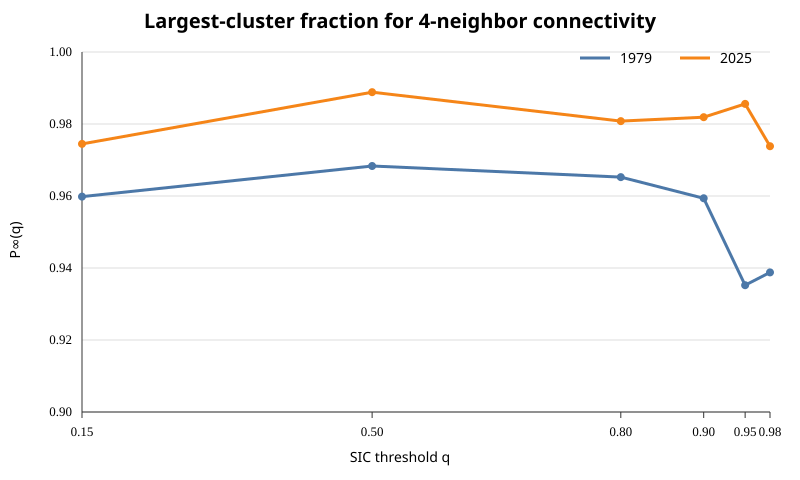
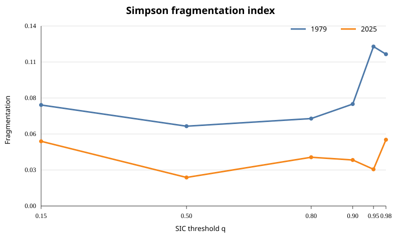
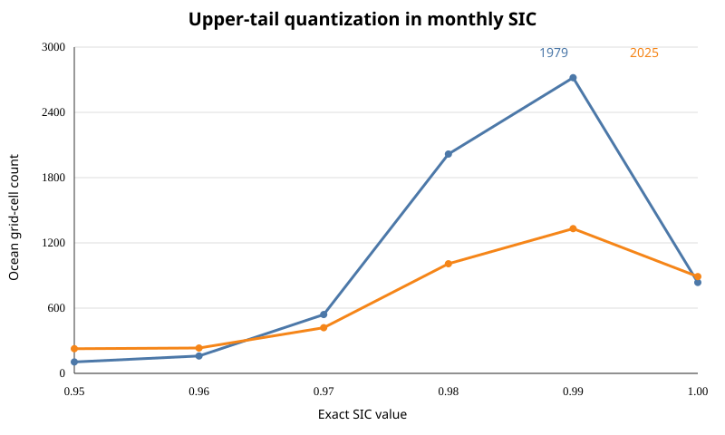

# Sea Ice Connectivity Modeling

A reproducible applied-mathematics study of Arctic sea-ice connectivity using NOAA/NSIDC G02202 Version 6 satellite sea-ice concentration fields.

## Research question

The project began by asking whether thresholded Arctic sea-ice concentration fields exhibit a reproducible finite-domain percolation transition. Real September 1979 and September 2025 fields show that the apparent strongest transition occurs only near `q = 0.99–1.00`, where the monthly CDR is strongly quantized. We therefore reject that critical-point interpretation and reframe the project around a more defensible structural question:

> How does Arctic sea-ice loss change connectivity and fragmentation at physically meaningful concentration thresholds, and do those structural changes contain information beyond total ice area?

## Main empirical findings

For 4-neighbor connectivity:

| Threshold | 1979 | 2025 |
|---|---:|---:|
| `q = 0.15` ice area | 6.272 million km² | 4.926 million km² |
| `q = 0.15` largest-cluster fraction | 0.960 | 0.974 |
| `q = 0.80` ice area | 4.742 million km² | 3.549 million km² |
| `q = 0.80` connected components | 29 | 13 |
| `q = 0.80` largest-cluster fraction | 0.965 | 0.981 |

The two snapshots therefore show substantially less ice in 2025, but the surviving high-concentration ice is more strongly dominated by one connected component. This is consistent with contraction toward a smaller connected core rather than a simple monotonic fragmentation story.

## Results at a glance







## Mathematical framework

For sea-ice concentration `C(x,t)` and threshold `q`, define the excursion set

`X_q(x,t) = 1{C(x,t) >= q}`.

Occupied cells form a graph under 4- or 8-neighbor adjacency. If connected-component physical areas are `S_i`, the primary connectivity statistic is

`P_inf(q,t) = max_i S_i / sum_i S_i`.

The project also evaluates connected-component counts, normalized cluster entropy, a Simpson-style fragmentation index, and boundary/edge-density diagnostics. Physical component areas are corrected for polar-stereographic map distortion.

## Repository structure

```text
Sea-Ice-Modeling/
├── README.md
├── requirements.txt
├── src/
│   └── analyze_two_snapshots.py
├── data/
│   ├── structural_metrics_1979_2025.csv
│   └── upper_tail_quantization_counts.csv
├── figures/
│   ├── pinf_conn4_qle098.svg
│   ├── components_by_threshold.svg
│   ├── fragmentation_by_threshold.svg
│   ├── edge_density_by_threshold.svg
│   └── upper_tail_quantization.svg
└── paper/
    └── sea_ice_connectivity_paper.tex
```

## Reproduce the analysis

Download the two public G02202 V6 monthly NetCDF files into `data/raw/`:

- `sic_psn25_197909_n07_v06r00.nc`
- `sic_psn25_202509_am2_v06r00.nc`

Then run:

```bash
pip install -r requirements.txt
python src/analyze_two_snapshots.py
```

Primary data source: NOAA/NSIDC Climate Data Record of Passive Microwave Sea Ice Concentration, G02202 Version 6, DOI `10.7265/b18j-z797`.

## Paper

**Connectivity and Fragmentation of Arctic Sea Ice in Satellite Concentration Fields**

The paper source is in `paper/sea_ice_connectivity_paper.tex`. A compiled PDF is provided separately as `sea_ice_connectivity_paper.pdf`.

## Scope

This repository contains a complete two-snapshot empirical study and a documented negative result for the original threshold-critical-point hypothesis. It does **not** claim a 1979–2025 climate trend from two years. A full historical trend study would require processing every annual September field and repeating the robustness analysis across sensor eras and independent SIC products.
